<!-- README de perfil de Yeray · modo historia. Edita los textos entre [corchetes] y los enlaces href="#". -->

<!-- ===== PANTALLA DE TÍTULO ===== -->

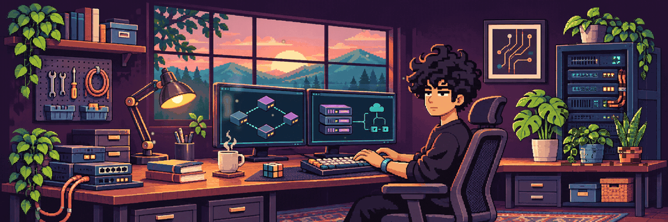

<a href="#nivel-1">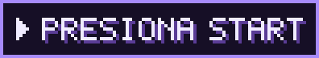</a>

<!-- ===== NIVEL 1 ===== -->

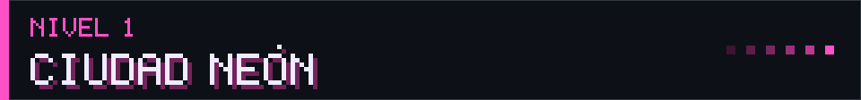

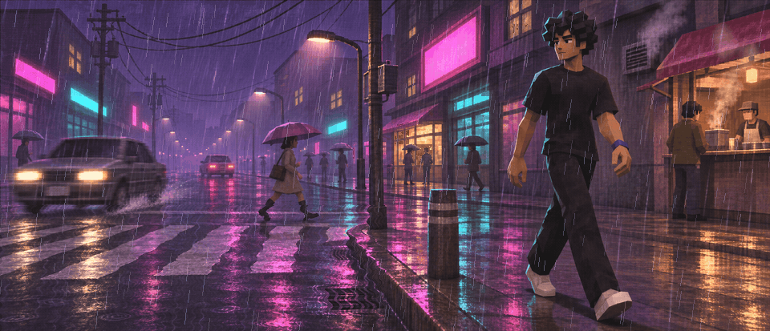

<table>
<tr>
<td width="58%">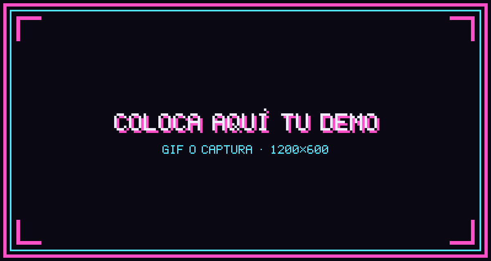</td>
<td width="42%">
<h3>⭐ Proyecto destacado</h3>

[Nombre del proyecto]

<strong>Qué resuelve</strong> [El problema en una o dos líneas.]

<strong>Qué hice yo</strong> [Tu parte exacta: diseño, código, datos…]

<strong>Dónde verlo</strong> <a href="#">Demo</a> · <a href="#">Código</a> · <a href="#">Caso técnico</a>

</td>
</tr>
</table>

<!-- ===== PERSONAJE ===== -->

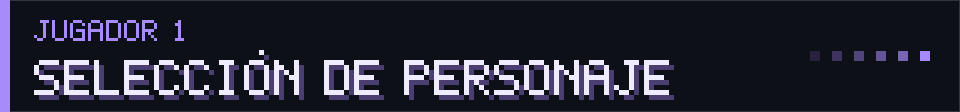

<table>
<tr>
<td width="34%" align="center"></td>
<td width="66%">
<h1>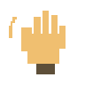 Yeray Gutierrez</h1>

<strong>Clase:</strong> Desarrollador de sistemas · <strong>Gremio:</strong> IB1 Investment Business One · <strong>Base:</strong> Trujillo, Perú

Construyo apps de escritorio, móviles y web para finanzas, y juegos de terror cuando nadie me ve.

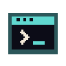 <strong>Inventario</strong> 
 <code>Expo</code>

🛡️ <strong>Subiendo de nivel:</strong> arquitectura de bases de datos con enfoque en seguridad.

</td>
</tr>
</table>

<!-- ===== MENÚ ===== -->

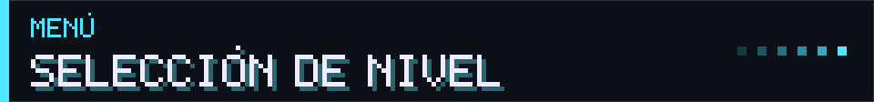

<table>
<tr>
<td><a href="#nivel-1">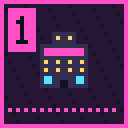 Neón ✓</a></td>
<td><a href="#nivel-2">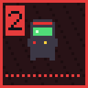 Paralelos</a></td>
<td><a href="#nivel-3">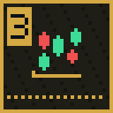 Fintech</a></td>
<td><a href="#nivel-4">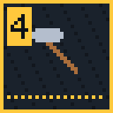 Taller</a></td>
<td><a href="#logros">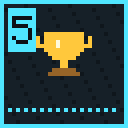 Logros</a></td>
<td><a href="#fuera">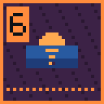 Fuera</a></td>
<td>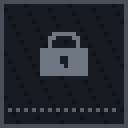 ???</td>
</tr>
</table>

<!-- ===== NIVEL 2 ===== -->

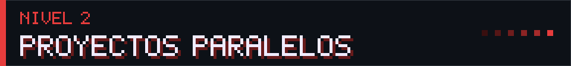

<table>
<tr>
<td width="34%" rowspan="2">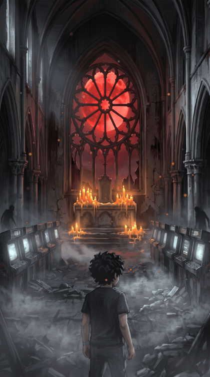</td>
<td width="33%"><h3>🧟 Valdeumbra</h3>
FPS de supervivencia zombi en el navegador. Lo hice para la universidad.

<a href="https://yeray-htpp.github.io/Valdeumbra/">▶ Jugar</a>
</td>
<td width="33%"><h3>[Título]</h3>
[Una o dos líneas.]

<a href="#">Enlace opcional</a>
</td>
</tr>
<tr>
<td><h3>[Título]</h3>
[Una o dos líneas.]

<a href="#">Enlace opcional</a>
</td>
<td><h3>🔒 ???</h3>
Espacio libre para el próximo experimento.
</td>
</tr>
</table>

<!-- ===== NIVEL 3 ===== -->

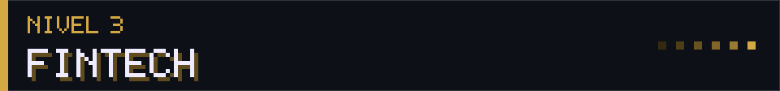

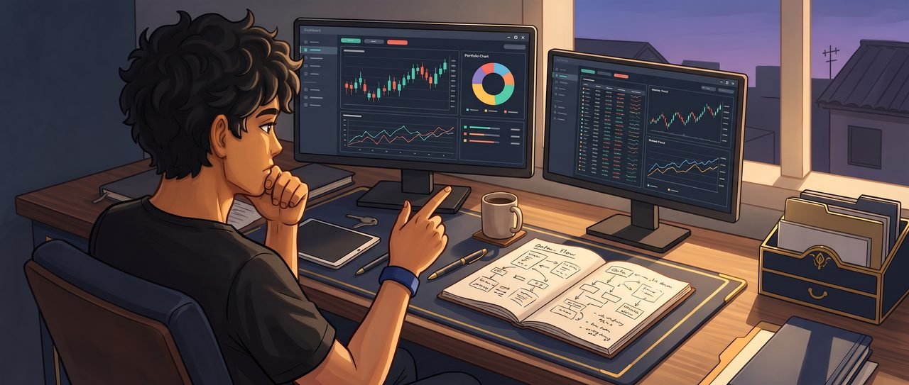

<table>
<tr><th colspan="2">📈 [Nombre del caso · p. ej. Asesor Financiero IB1]</th></tr>
<tr><td width="22%"><strong>Problema</strong></td><td>[Qué necesitaba resolverse y para quién.]</td></tr>
<tr><td><strong>Mi aporte</strong></td><td>[Qué diseñaste o construiste tú.]</td></tr>
<tr><td><strong>Evidencia</strong></td><td>[Captura, diagrama o resultado que se pueda mostrar.]</td></tr>
</table>

Ampliar: decisiones, herramientas y resultados

[Cuando tengas material: por qué elegiste cada herramienta, qué probaste y qué salió.]

El software de IB1 es privado: aquí va el caso técnico, no el código.

<!-- ===== NIVEL 4 ===== -->

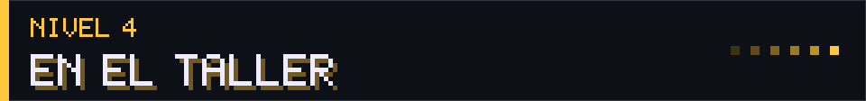

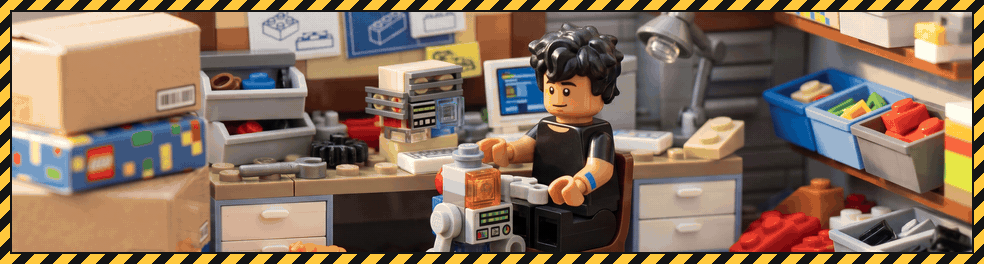

<table>
<tr><td width="34%">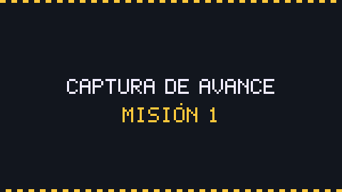</td><td><h3>🔨 Construyendo: [nombre]</h3>
<strong>Va en:</strong> [punto actual] <strong>Sigue:</strong> [siguiente paso]

<b>▰▰▰▱▱</b>
</td></tr>
<tr><td>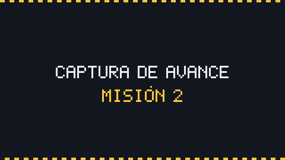</td><td><h3>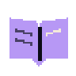 Aprendiendo: arquitectura de bases de datos</h3>
<strong>Va en:</strong> [punto actual] <strong>Sigue:</strong> [siguiente paso]

<b>▰▰▱▱▱</b>
</td></tr>
<tr><td>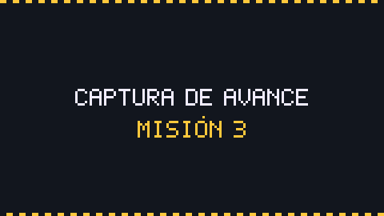</td><td><h3>🕯️ Preparando: un nuevo juego de terror</h3>
<strong>Va en:</strong> [punto actual] <strong>Sigue:</strong> [siguiente paso]

<b>▰▱▱▱▱</b>
</td></tr>
</table>

<!-- ===== LOGROS ===== -->

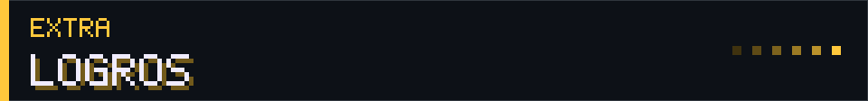

<table>
<tr>
<td width="33%" align="center">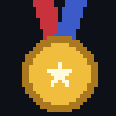<h3>Primer juego publicado</h3>
📅 [fecha] 🔗 <a href="https://yeray-htpp.github.io/Valdeumbra/">Valdeumbra</a>
</td>
<td width="33%" align="center">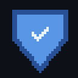<h3>Cajathon 2026</h3>
📅 [fecha] 🔗 [evidencia]
</td>
<td width="33%" align="center">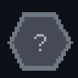<h3>Logro secreto</h3>
Aún no desbloqueado
</td>
</tr>
</table>

<!-- ===== CINEMÁTICA ===== -->

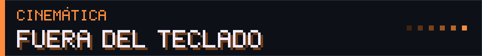

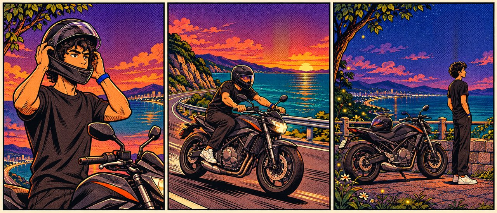

<strong>Quién soy:</strong> [dos líneas con tu voz.]

<strong>Qué me gusta:</strong> [la moto, el terror, la música…]

<strong>Fuera del trabajo:</strong> [qué haces cuando apagas la compu.]

<!-- ===== CONTINUAR ===== -->

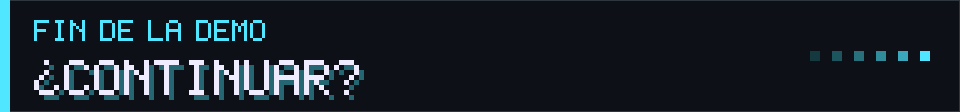

<a href="#">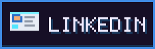</a>&nbsp;
<a href="#">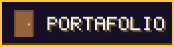</a>&nbsp;
<a href="#">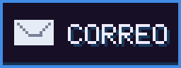</a>&nbsp;
<a href="#">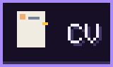</a>

Todos mis proyectos están en el portafolio. <a href="#inicio">↑ Volver a la pantalla de título</a>

